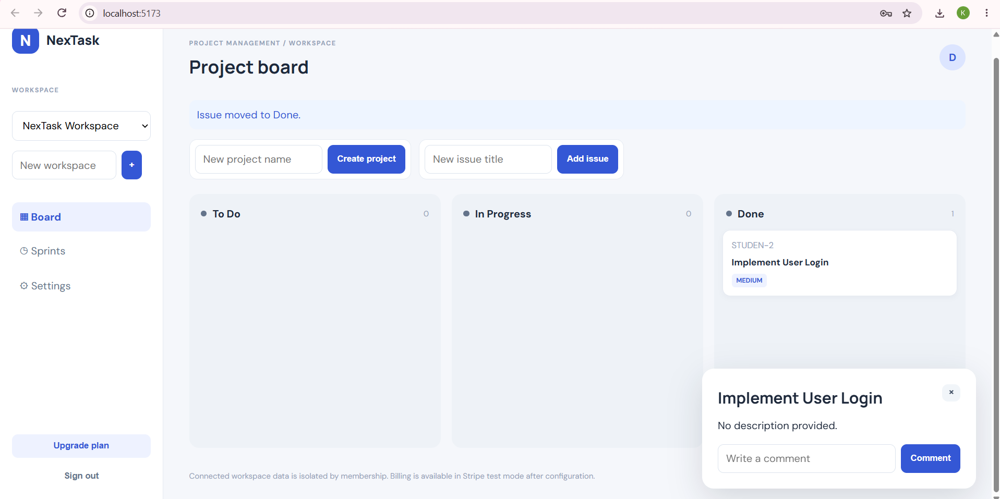
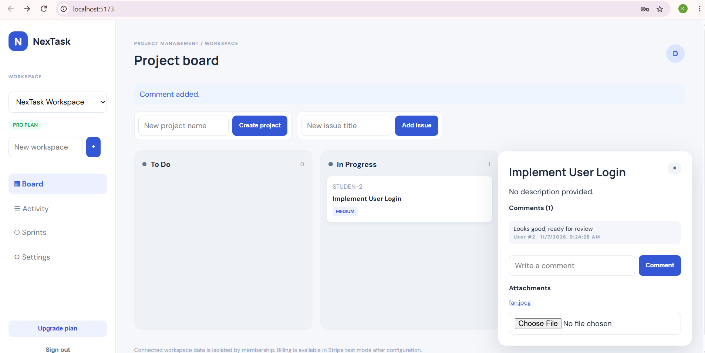
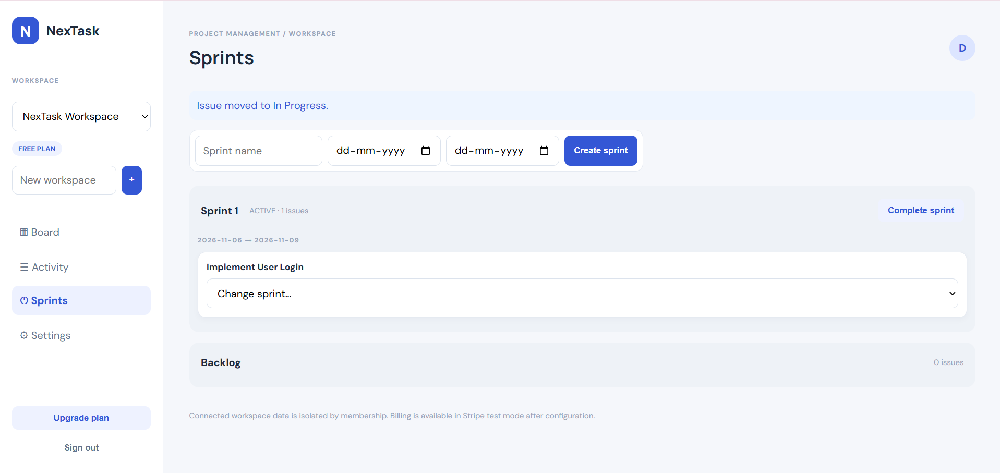
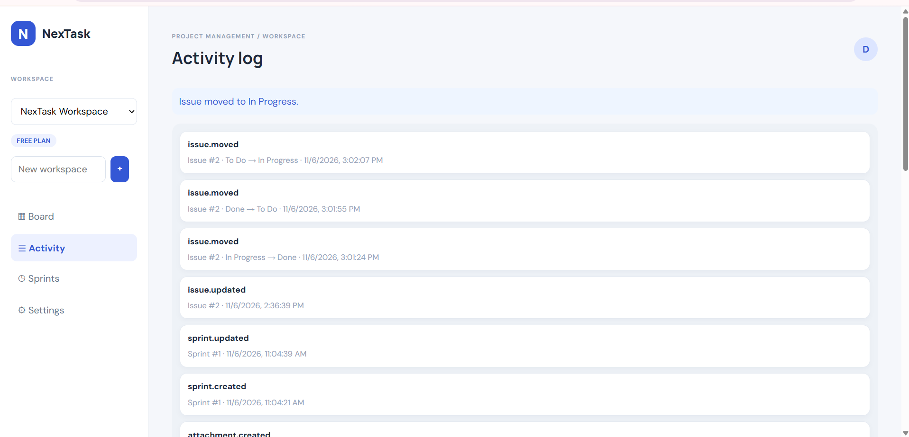
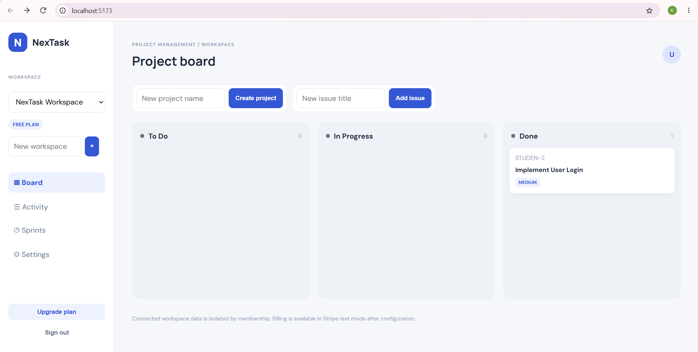
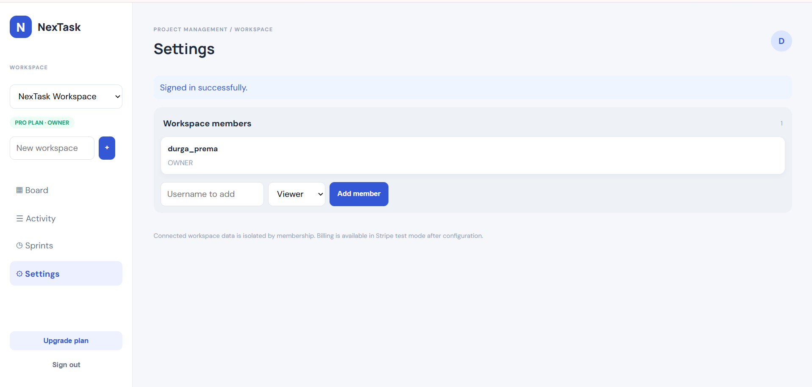
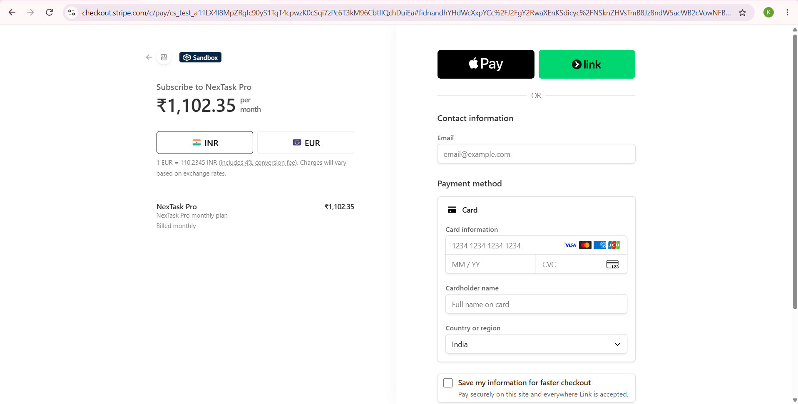
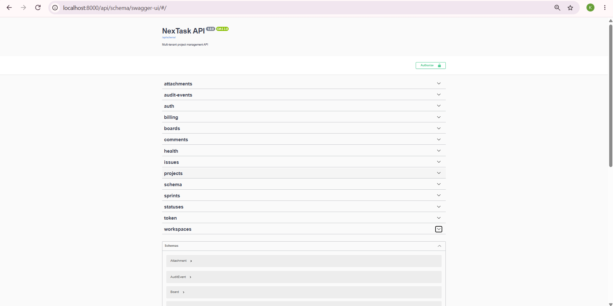

# NexTask: Multi-Tenant SaaS Project Management Platform

A Jira-like project management app built for the FS-04 internship project. Each company gets its own isolated workspace with a Kanban board, sprints, comments, attachments, an audit log and Stripe test-mode billing.

## Demo video

Screen recording of the running application (about 4 minutes): Docker services, Kanban board, issue comments and attachments, sprints, activity log, workspace members and roles, Stripe test checkout, and the read-only Viewer role.

**Watch here:** https://drive.google.com/drive/folders/14_gXNUf1Lz9s5cUj5xSYHmJOfND09AiK

The application runs locally with Docker Compose (see Quick start). Screenshots are in the section below.

## Tech stack
- **Backend:** Python 3.11, Django 5.2, Django REST Framework, SimpleJWT
- **Database:** PostgreSQL 16
- **Frontend:** React + Vite, `@dnd-kit` for drag-and-drop
- **Background jobs:** Celery + Redis
- **Billing:** Stripe Billing (test mode)
- **DevOps:** Docker Compose, GitHub Actions

## Features
| Area | What works |
|---|---|
| Multi-tenancy | Shared schema with a `workspace` foreign key on every tenant record. All querysets are filtered by the caller's workspace membership. |
| Auth and roles | JWT login. Roles: `OWNER`, `ADMIN`, `MEMBER`, `VIEWER`. Viewers are read-only (403 on writes). |
| Kanban board | Three workflow columns (To Do, In Progress, Done) with drag-and-drop. Status changes are saved through `PATCH /api/issues/{id}/move/`. |
| Issues | Create, update, comment (comments are listed in the issue panel), attach files, assign to sprints. |
| Members and roles | Owners and admins add existing users to a workspace from **Settings** with the role Admin, Member or Viewer. Viewers are read-only. |
| Sprints | Create sprints with dates, assign backlog issues, start or complete a sprint. |
| Attachments | Upload files to an issue and open them from the issue panel. |
| Audit log | Every create, update, move, comment, upload and report request is recorded and shown on the **Activity** page. |
| Background jobs | Celery worker builds a workspace report: `POST /api/workspaces/{id}/report/` (owner or admin only). |
| Billing | Stripe Checkout (subscription) and a webhook that upgrades the workspace to PRO. |
| Plan limits | FREE: 3 projects and 10 issues per workspace (HTTP 402 when exceeded). PRO: unlimited. |

## Screenshots

| | |
|---|---|
|  |  |
| Kanban board | Issue comments and attachments |
|  |  |
| Sprints | Activity (audit) log |
|  |  |
| FREE plan workspace | PRO plan and workspace members |
|  |  |
| Stripe Checkout (test mode) | Swagger API docs |

More evidence:
- [Celery report job succeeded](docs/screenshots/07-celery.png)
- [Database: workspace upgraded to PRO](docs/screenshots/09-database-pro.png)
- [Stripe webhook returns 200](docs/screenshots/11-webhook-200.png)
- [Backend tests in CI](docs/screenshots/06-ci-tests-11.png)
- [GitHub Actions runs](docs/screenshots/13-github-actions.png)
- [Published Docker images (GitHub Packages)](docs/screenshots/14-github-packages.png)
- [Architecture diagram](docs/screenshots/15-architecture.png)

## Quick start (Docker)
1. Copy the example env file and fill in your own values:
   ```bash
   cp .env.example .env        # Windows PowerShell: copy .env.example .env
   ```
   Set `DJANGO_SECRET_KEY`. Stripe values are only needed for the billing demo (see below).
2. Start everything:
   ```bash
   docker compose up --build
   ```
   Migrations run automatically when the backend starts.
3. Open:
   - Frontend: http://localhost:5173
   - API: http://localhost:8000/api/
   - API docs (Swagger): http://localhost:8000/api/schema/swagger-ui/
4. In the app, click **Create account**, sign in, create a workspace, then a project and some issues.

Services started by Compose: `db` (PostgreSQL), `redis`, `backend` (Django), `celery` (worker), `frontend` (Vite).

Useful commands:
```bash
docker compose up -d                              # start in the background
docker compose ps                                 # check service status
docker compose logs celery --tail 20              # worker logs
docker compose exec backend python manage.py test # run the test suite
docker compose down                               # stop (data is kept)
```

## Stripe test-mode setup
1. In the Stripe dashboard (test mode), create a product with a recurring monthly price. Copy the price id (`price_...`) into `STRIPE_PRICE_ID`.
2. Copy the test secret key (`sk_test_...`) into `STRIPE_SECRET_KEY`.
3. Forward webhooks to the backend with the Stripe CLI:
   ```bash
   stripe listen --events checkout.session.completed,customer.subscription.updated,customer.subscription.deleted --forward-to localhost:8000/api/billing/webhook/
   ```
   Copy the printed `whsec_...` value into `STRIPE_WEBHOOK_SECRET`.
4. Recreate the backend so it reads the new values: `docker compose up -d --force-recreate backend`.
5. Click **Upgrade plan** in the sidebar and pay with the test card `4242 4242 4242 4242` (any future expiry, any CVC).
6. The webhook sets the workspace plan to **PRO** and the sidebar badge changes from FREE PLAN to PRO PLAN.

Never commit `.env` or use live keys. `.env` is listed in `.gitignore`.

## Tests and CI
- 11 automated tests (`backend/core/tests.py`) cover tenant isolation, viewer permissions, member management, plan limits, the Stripe webhook upgrade, sprint creation and cross-workspace sprint assignment. Latest result: 11 of 11 passing (see [Test results](docs/TEST_RESULTS.md)).
- GitHub Actions (`.github/workflows/ci.yml`) runs `manage.py check` and the test suite against PostgreSQL and Redis on every push and pull request. It also builds the frontend and, on pushes to main, publishes the backend and frontend Docker images to GitHub Container Registry.
- Backend code is formatted with Black and import order is checked with Ruff.

```bash
docker compose exec backend python manage.py test
```

## Project layout
```
backend/    Django project (config/) and the core app (models, views, serializers, tasks, tests)
frontend/   React + Vite single-page app
docs/       Architecture, API overview, test plan and results, reflection, presentation, screenshots
.github/    CI workflow
```

## Documentation
- [Architecture and data model](docs/ARCHITECTURE.md)
- [API overview](docs/API.md)
- [Test plan](docs/TEST_PLAN.md)
- [Test results](docs/TEST_RESULTS.md)
- [Individual reflection](docs/INDIVIDUAL_REFLECTION.md)
- [Project presentation (PPTX)](docs/NexTask_FS04_Presentation.pptx)

## Known limitations and next steps
- The pipeline publishes Docker images but does not deploy them to a hosting service; the demo runs locally with Docker Compose.
- Sprint creation uses the workspace's first project; a project picker is a planned improvement.
- Uploaded files are served by Django in development mode. A production setup should use object storage (for example S3) with signed URLs.
- Billing currently supports one paid plan (PRO).
- Members can only be added if they already have an account; email invitations are not implemented.
- The frontend does not refresh the access token automatically yet.
