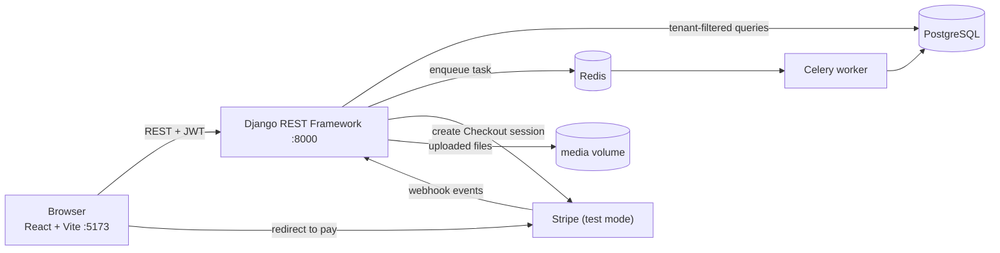
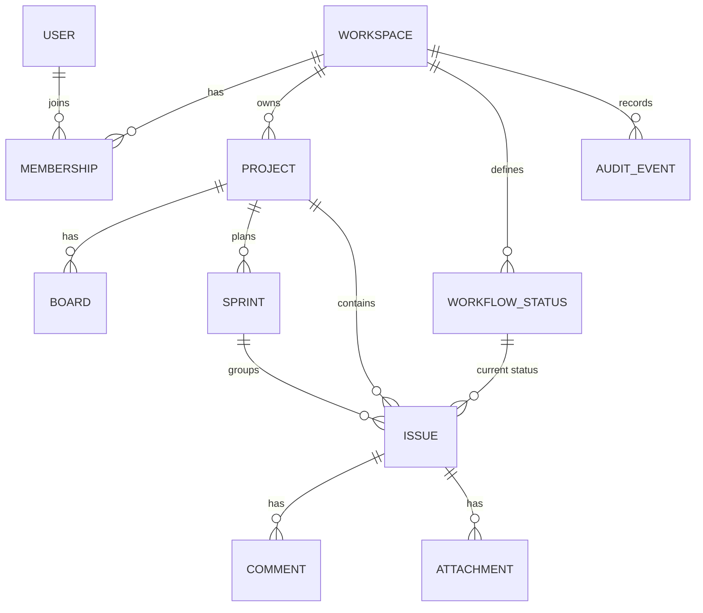

# NexTask Architecture

## Tenant strategy
Shared PostgreSQL schema. Every tenant-owned record has a `workspace` foreign key. A user can reach a record only through a `Membership` in that workspace, so querysets are always filtered by the caller's memberships. When a request names related objects (project, status, sprint, board), the API checks that they belong to the same workspace as the issue.

Roles: `OWNER`, `ADMIN`, `MEMBER` (can write), `VIEWER` (read-only).

## System overview

## Data model

Every box except `USER` also carries a `workspace_id`.

## Components
| Component | Responsibility |
|---|---|
| React + Vite | Workspace switcher, Kanban board (drag-and-drop), sprints, activity log, issue panel with comments and attachments |
| Django REST Framework | JWT authentication, role checks, workspace-scoped CRUD, plan limits, Stripe endpoints |
| PostgreSQL | All application data |
| Redis + Celery | Background jobs (workspace report, notification task) |
| Stripe Billing | Subscription Checkout and webhook that upgrades a workspace to PRO |
| Docker Compose | Runs db, redis, backend, celery and frontend together |
| GitHub Actions | Runs `manage.py check` and the test suite on every push |

## Main flows
**Moving an issue:** the board sends `PATCH /api/issues/{id}/move/`. The API checks membership and write role, validates the target status belongs to the workspace, saves it, and writes an audit event.

**Generating a report:** `POST /api/workspaces/{id}/report/` (owner or admin) queues `build_workspace_report` in Redis. The Celery worker runs it and logs the result.

**Upgrading a plan:** the app calls `POST /api/billing/checkout/`, the user pays on Stripe, Stripe calls `POST /api/billing/webhook/`, and the backend sets `plan=PRO` and `subscription_status=active` and stores the Stripe customer and subscription ids.

**Plan limits:** on create, FREE workspaces are limited to 3 projects and 10 issues (HTTP 402). PRO is unlimited.